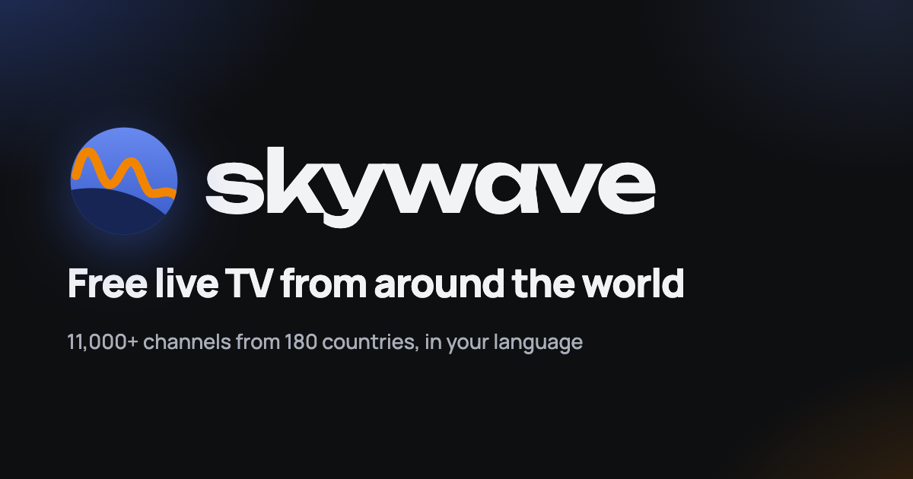
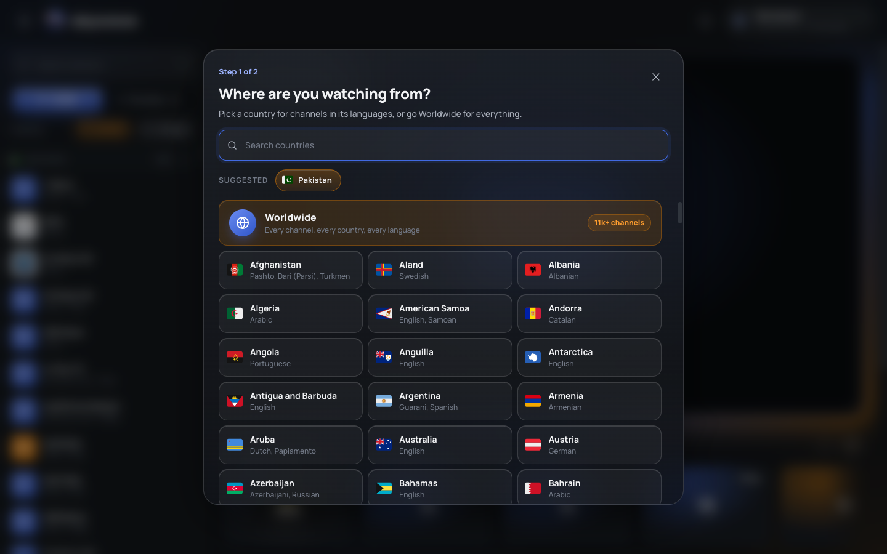
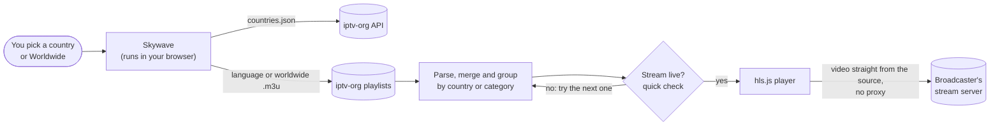

# Skywave

Skywave is a web app for watching free, publicly available live TV channels from around the world in the browser. Pick a country to get channels in its languages, or go **Worldwide** and browse more than 11,000 channels from 180 countries by country or by category. It opens straight onto a channel that is live right now.

It is a static site: plain HTML, CSS and JavaScript, with no backend, no build step and no accounts. Channel lists come from the open-source [iptv-org](https://github.com/iptv-org/iptv) project, and video is played by [hls.js](https://github.com/video-dev/hls.js) directly from each broadcaster's stream.



## Features

- **Country and language playlists.** Each country maps to its languages, and you can keep only channels registered in that country or see every channel in those languages.
- **Worldwide.** Every channel from every country, grouped by country or by category. Your own country loads first, so channels appear in about a second while the rest downloads with a progress bar.
- **Starts on a live channel.** On open it tries your last-watched channel, then favourites, then the list, checking a dozen streams at once and skipping the ones that are offline.
- **Player.** Play and pause (tap the centre on phones), previous and next channel, volume, picture-in-picture and full screen. If the browser blocks sound it starts muted with a "Tap for sound" button.
- **Channel list.** Collapsible groups, search, favourites, and a row of related channels under the player.
- **Keyboard shortcuts** on desktop: `K` play/pause, `F` full screen, `M` mute, `N`/`P` next/previous, `/` search, `?` shortcut list.
- **Responsive.** A sidebar on desktop; on phones, a slide-out channel drawer and a player that stays pinned while you scroll.
- **SEO and sharing.** Title, description, link-preview image, schema.org structured data, web app manifest and icons.

## How it works



1. The [iptv-org API](https://github.com/iptv-org/api) (`countries.json`) gives each country's language codes.
2. Skywave downloads the playlist for each of those languages, or the full worldwide playlist, and parses it in the browser.
3. Channels are merged, de-duplicated and grouped. The country of each channel comes from its `tvg-id` (for example `GeoNews.pk@SD` is Pakistan).
4. To start a channel by itself, Skywave fetches the first bytes of a dozen candidate streams in parallel and plays the first one that answers with a valid HLS playlist.
5. hls.js plays the stream directly from the broadcaster's server. Nothing is hosted, recorded or relayed by Skywave.

## Run locally

```bash
git clone https://github.com/MursleenAmjad/skywave.git
cd skywave
python3 -m http.server 8080
# open http://localhost:8080
```

Any static host works for deployment (GitHub Pages, Netlify, Vercel, Cloudflare Pages): publish the folder as it is.

## Project structure

| Path | What it holds |
|---|---|
| `index.html` | Page markup, SEO and link-preview tags, icon sprite, shortcuts popover |
| `css/styles.css` | Design tokens (charcoal, royal blue, tangerine), glass components, responsive layout |
| `js/app.js` | Playlist loading and parsing, country picker, channel list, player, default-channel search |
| `js/languages.js` | Names for the language codes used in iptv-org country data |
| `manifest.webmanifest`, icons, `og-image.png`, `robots.txt` | Install, search and sharing assets |
| `design/` | Logo exploration (not linked from the site, excluded from search) |

## Known limitations

- **Streams come and go.** Many public streams are offline at any moment, geo-blocked, or block playback on other websites (CORS). Skywave shows a clear error and lets you skip to the next channel; it never proxies streams to get around these limits.
- **http streams on an https site** are blocked by browsers. Skywave retries the same address over https and shows an error if that fails.
- **One page.** Channels load into a single page, so search engines see one page rather than one per country or category.
- **iPhone full screen** uses Apple's native video player, because iPhone Safari only allows the video element itself to go full screen.

## Before publishing your own copy

- Set `CONFIG.reportUrl` in `js/app.js` to your own email or form, so broadcasters can ask for a channel to be removed.
- Once the site has a domain, add `og:url`, a canonical link, absolute link-preview image URLs and a `sitemap.xml`.

## Principles

- Free, with no ads, payments or sign-up.
- Streams play directly from their source; nothing is hosted or relayed.
- Geo-blocks and logins are never bypassed.
- Every page links to a way to report a channel.

## Credits

- Channel data: [iptv-org](https://github.com/iptv-org) (Unlicense). Streams belong to their broadcasters.
- Player: [hls.js](https://github.com/video-dev/hls.js) (Apache 2.0).
- Flag font: [Twemoji](https://github.com/twitter/twemoji) via `country-flag-emoji-polyfill` (CC-BY 4.0).
- Fonts: [Manrope](https://fonts.google.com/specimen/Manrope) and [Unbounded](https://fonts.google.com/specimen/Unbounded) (SIL Open Font License).

## Author

Created by **Mursleen Amjad**: [LinkedIn](https://www.linkedin.com/in/mursleen-amjad/)
